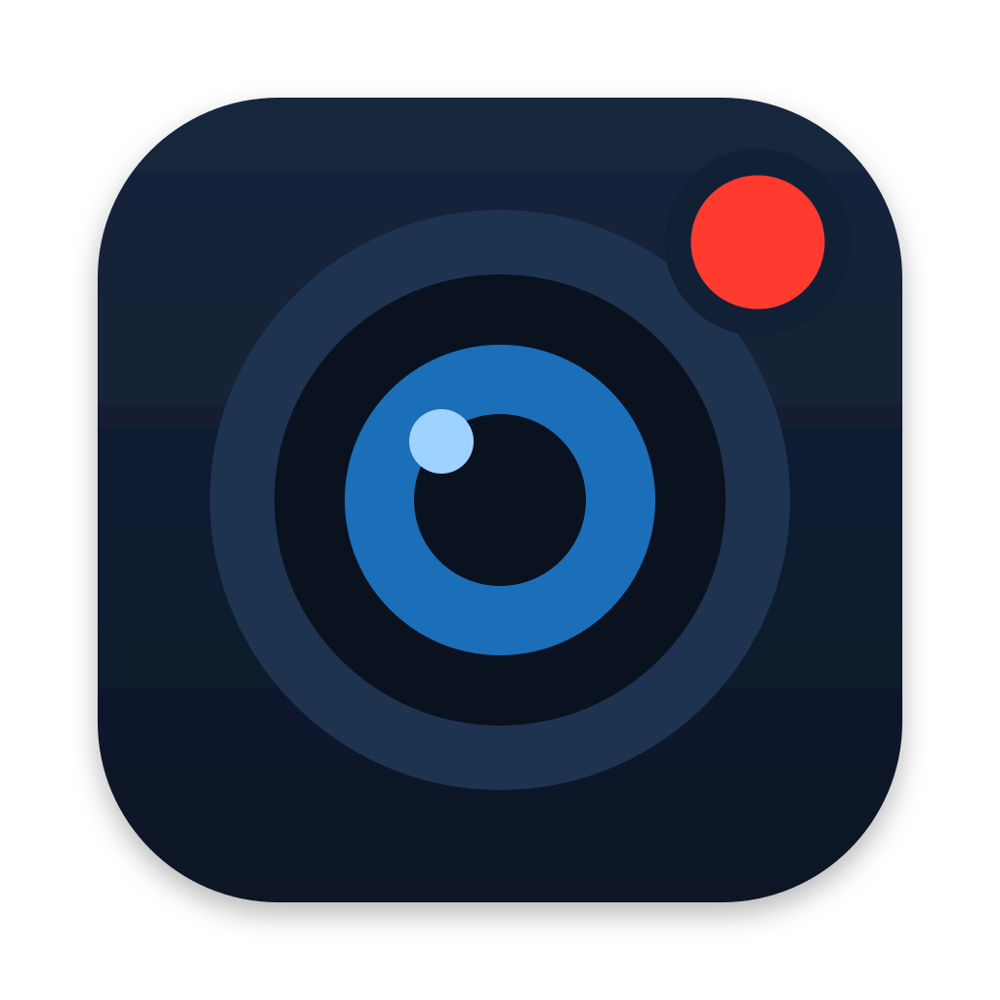

<p align="center"></p>

<h1 align="center">Lensbell</h1>

<p align="center">Mac notifications, with the snapshot, for your EZVIZ cameras.</p>

---

The EZVIZ app only pushes alerts to your phone. Lensbell watches your EZVIZ cloud account and, whenever a camera detects something, shows a native macOS notification with the capture image. Notifications stay in Notification Center, and clicking one opens the full capture in Preview.

> **Unofficial.** Lensbell is not affiliated with, endorsed by, or sponsored by EZVIZ. "EZVIZ" is a trademark of its respective owner and is used here only to describe compatibility. Lensbell relies on the community library [pyEzvizApi](https://github.com/RenierM26/pyEzvizApi), which uses the same (undocumented) cloud API as the EZVIZ mobile app, so it may break if EZVIZ changes that API.

## Features

- Native macOS notifications with the capture attached, kept in Notification Center
- Click to open the full-size image
- Encrypted captures are decrypted automatically (handled by pyezvizapi)
- Runs in the background via `launchd` and starts again after a reboot
- Captures saved locally in `captures/` and cleaned up after 14 days
- Optional large floating popup that shows the capture

## Requirements

- macOS 12 or later
- Python 3 (`python3`)
- Xcode Command Line Tools for `swiftc` (`xcode-select --install`)
- An EZVIZ account with your camera(s) added in the EZVIZ app

Tested with an EZVIZ H8c on macOS (Apple Silicon). Other EZVIZ cameras supported by pyezvizapi should work too.

## Install

```bash
git clone https://github.com/harsxv/lensbell.git
cd lensbell
./setup.sh
```

The setup:

1. Creates a Python virtual environment and installs a pinned version of `pyezvizapi`.
2. Builds two small Swift helpers: `Lensbell.app` (installed to `~/Applications`; posts the notifications) and `popup`.
3. Logs in to EZVIZ once. You'll be asked for an MFA code if your account uses one. Only the session token is saved to `ezviz_token.json` (mode 600); your password is not stored.
4. Installs a `launchd` agent that runs `watcher.py` in the background.

When macOS asks whether **Lensbell** may send notifications, choose **Allow**.

**Tip:** to keep alerts on screen until you click them, open *System Settings → Notifications → Lensbell* and set the style to **Persistent** (called *Alerts* on older macOS).

## Configuration

Set these environment variables before running `./setup.sh` (or edit `~/Library/LaunchAgents/io.github.harsxv.lensbell.plist`):

| Variable | Default | Description |
|---|---|---|
| `LENSBELL_STYLE` | `notification` | `notification`, `popup` or `both` |
| `LENSBELL_POLL_SECONDS` | `10` | How often to check for new alarms |
| `LENSBELL_REGION` | *(pyezvizapi default)* | EZVIZ API host, e.g. `apiisgp.ezvizlife.com`. Usually asked during setup. |
| `LENSBELL_KEEP_DAYS` | `14` | Days to keep saved captures |
| `LENSBELL_POPUP_SECONDS` | `12` | How long the popup stays on screen |

Example: `LENSBELL_STYLE=both ./setup.sh`

## How it works

Every `LENSBELL_POLL_SECONDS`, `watcher.py` asks the EZVIZ cloud for each camera's last alarm time. When it changes, the watcher downloads and decrypts the alarm image with `pyezvizapi save image --image-url`, then passes it to `Lensbell.app`, which posts the notification.

Alerts arrive a few seconds after they reach your phone. If several detections happen within one polling interval, only the latest is shown.

## Security & privacy

- `ezviz_token.json` gives access to your EZVIZ account. Keep it private. It's already in `.gitignore`. **Never commit or share it.**
- `captures/`, `watcher.log` and `state.json` contain your camera images and names. They're git-ignored as well.
- Lensbell talks only to EZVIZ's servers. No third-party service is involved.
- `pyezvizapi` is pinned in `requirements.txt` so an upstream update can't change behaviour unexpectedly. Review the release notes before you bump it.
- During the one-time login your password is passed to the pyezvizapi CLI as an argument, so it is briefly visible to other processes of your user account.
- To revoke access, delete `ezviz_token.json` and change your EZVIZ password.

## Disclaimer

Use at your own risk. You are responsible for complying with the EZVIZ terms of service that apply to your account. Lensbell only accesses your own account and your own cameras.

## Uninstall

```bash
./uninstall.sh          # stops the watcher and removes Lensbell.app
rm -rf lensbell         # removes everything, including your token and captures
```

## Troubleshooting

- **No notifications:** run `tail -f watcher.log` and trigger a detection. You should see `New alarm: ...`.
- **"no camera with a last_alarm_time field":** your camera model reports alarms differently. Please open an issue and include the redacted output of `.venv/bin/pyezvizapi --token-file ezviz_token.json --json devices status | grep -i alarm`.
- **Login fails with a region error:** delete `ezviz_token.json`, re-run `./setup.sh`, and enter your region's API host.
- **Old or blank icon in notifications:** run `killall NotificationCenter` to refresh macOS's icon cache.
- **Duplicate alerts:** if you use iPhone Mirroring, your phone's EZVIZ notifications appear on the Mac too. Turn them off under *System Settings → Notifications → iPhone*.

## Icon

The app icon source is `assets/icon.svg`. To change it, export a 1024×1024 `assets/icon.png` and re-run `./setup.sh`.

## License

MIT
